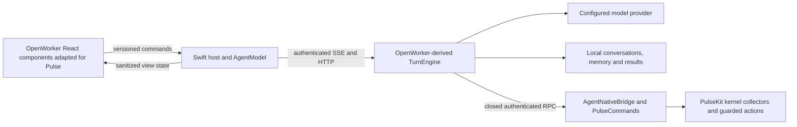

# OpenWorker → Ask Pulse: source map and port design

Date: October 17, 2026. Status: core runtime/UI implemented on `feat/openworker-pulse-runtime`; local validation and release review recorded in the implementation plan. User continuation authorized implementation with Swift/native tools/Keychain retained. No merge approval granted.

## Scope and evidence

User selected **agent runtime and conversation UI first**. Connectors, scheduled tasks, teams, remote machines, cloud accounts and voice are later work, not hidden requirements for this port. Deliver actual source adaptations of OpenWorker's engine and React components, not an OpenWorker-themed skin over Agno.

Reference: [andrewyng/openworker](https://github.com/andrewyng/openworker), cloned for read-only research at `/tmp/pulse-openworker-research-20261017`. Pin reviewed source to **`5bf0d2fb8c728932fdbc6b49a24113aebc2a4ddd`**, whose Python package declares version 0.3.4. All upstream links below name that commit. MIT license permits source adaptation; retain its copyright and complete license alongside copied code, and record changed files. This is source inspection, not a claim that upstream tests, UI or providers were executed successfully.

Pulse baseline: `feat/pulse-agent-harness` at `809d203`, including main through landing PR #88. Existing `feat/pulse-agent-openworker` is older work with transcript/context fixes; its name does not mean it contains an OpenWorker runtime. Preserve current harness work and unrelated untracked files. Before implementation, check current remote ancestry and use the mandated feature-branch/PR workflow; do not silently start from main and discard this unmerged harness. If main still lacks that dependency, land the current harness first or explicitly stack the migration PR on it.

Reviewed Pulse's wiki, product specification §12, prior approved harness design, Python runtime, native client/web bridge/toolkit, React renderer, Makefile and bundle allowlist. Background target remains <1% CPU/<50 MB RSS with two-second native sampling. Existing wiki records 59.1 MiB hidden RSS: this is an unresolved baseline, not proof of compliance. Interactive Python/WebKit costs must be reported separately.

## Architecture choices

1. **Adapt OpenWorker core inside existing Pulse host — recommended.** Replace Agno with source-derived TurnEngine/provider/context logic and replace assistant-ui with adapted OpenWorker conversation components. Keep authenticated SSE, native bridge, Keychain, Swift shell and packaging. Smallest route to the requested runtime and UI with Pulse's existing permissions and tools.
2. **Embed the full OpenWorker server and React app.** Closest whole-product fork, but starts unrelated services and imports workspace/shell/cloud/team behavior. Its server manager alone is 8,756 lines at the pinned revision. Too much coupling for runtime/UI-first scope.
3. **Keep Agno and reproduce selected OpenWorker features.** Least migration work, but retains the current harness and does not satisfy the requested port.

Do option 1. Avoid Tauri, a second desktop shell, a second tool execution path, and a new browser-to-daemon connection. Do not create a general plugin system or replacement protocol framework.

## Component map

Paths in the upstream column are relative to the pinned OpenWorker repository. Destination paths are relative to Pulse. This research map includes later UI capabilities; the implementation manifest below distinguishes shipped boundaries from deferred features.

| OpenWorker component | Current Pulse counterpart | Port decision |
| --- | --- | --- |
| `coworker/engine.py`: `TurnEngine` | `pulse-agent/agent.py`, Agno `Agent` | Adapt the actual owned loop: streaming, tool batches, interruption, retry, dangling-call repair, truncation handling, questions and plans. Construct directly; do not call upstream `build_engine()`. |
| `coworker/agent.py`: whole-product assembly | `create_pulse_agent()` | Replace with Pulse-only assembly. Upstream assembly imports scheduling, subscriptions, shell/files, connectors, sandbox, subagents and workspace trust. |
| `coworker/events.py` | `server.py` translation and `AgentEnvelope` | Keep upstream internal event concepts; translate at the existing SSE boundary. Extend Pulse's typed contract for questions, plans, progress and usage. |
| `coworker/tools/registry.py`: `ToolRegistry`/`ToolSpec` | Agno `PulseToolkit` registration | Retain schema/registry approach. Make Pulse tools plain async callables; engine must await them. Upstream registry execution is synchronous. |
| `coworker/permissions.py`, `risk.py` | Agno confirmation requirements plus toolkit preview checks | Explicit Pulse read/action classification. Unknown tools denied. Mutations always require the exact human decision; preserve native guards and fresh consumed previews. |
| `coworker/providers/base.py`, provider implementations | `pulse-agent/providers.py` | Adapt `ProviderClient`, normalized turns/usage and existing five Pulse transports. Bind one explicit provider/config to each run; no environment fallback or mutable global router credential changes. |
| `coworker/compaction.py` | `budget.py`, `CheckpointSummary` | Port outbound-view compaction and working-state preservation. Keep canonical transcript separate; reserve output and tool-schema budget. |
| `coworker/toolresult.py` | Agno `ResultStore` | Adapt spill/paging behavior with a hard serialized-size bound, Pulse-owned result IDs and a read-only result retrieval tool. No `read_file`/shell instructions. |
| `coworker/conversations.py`, `sessions.py` | `storage.py` and Agno SQLite sessions | Port canonical message/pairing/recovery semantics into Pulse-owned storage. Prefer one SQLite transaction for messages, run state and pending decisions over index + JSONL dual writes. |
| `coworker/memory/` | custom `PulseMemoryStore` | Port bounded recall and management ideas; preserve Pulse evidence/provenance fields, secret filtering and off = no recall/no writes. |
| `coworker/skills/` | Agno `LocalSkills`, bundled Pulse skill | Progressive catalog + read-only `load_skill` and contained reference reads. Only bundled Pulse skill; no scripts or agent-authored persistent instruction installation. |
| `coworker/tools/ask.py`, `plan.py`, `todo.py`, `interactions.py` | No structured question/plan/task UI | Adapt schemas and cards. Questions are not approvals; approving an investigation plan does not approve its future mutations. |
| `coworker/audit.py` | event replay and native UndoJournal | Local bounded action records with run/call/decision provenance and redaction. UndoJournal remains authority for file actions. |
| `coworker/server/app.py`, `manager.py` | authenticated `pulse-agent/server.py` | Retain Pulse server/lifecycle; replace engine integration only. Carry necessary retry/gate/recovery semantics without importing full manager. |
| GUI `types.ts`, `cardPayloads.ts`, `itemsFromMessages.ts`, `gateReconciliation.ts` | `bridge.ts`, Swift timeline reduction | Adapt stable view types and live/history reconciliation. Same pending decision must render consistently live, after replay and after reopening. |
| GUI `components/Transcript.tsx`, `Markdown.tsx`, `humanize.ts`, `streamGate.ts` | assistant-ui message conversion | Port grouped narration/tool progress and safe Markdown. Keep final answers and pending approval cards visible. Replace tool wording with Pulse operations. |
| GUI `components/Composer.tsx`, `composerDraft.ts` | assistant-ui composer | Adapt send/stop, per-session drafts and keyboard behavior. Remove Tauri, voice, workspace/team/connector dependencies. |
| GUI `Sidebar.tsx`, session actions/search | simple conversation list | Pulse conversation rail: new, recent, rename, archive/delete with clear local-history effects, bounded search. Retain selection on reopening. |
| GUI `ApprovalCard.tsx`, `PlanCard.tsx`, question cards | generic approval tool card | Pulse-specific affected-item review, exact action decisions, question choices/free text and plan accept/revise/decline. No blanket approval controls. |
| GUI `RightRail.tsx`, `TodoPanel.tsx`, `MemorySection.tsx`, `usage.ts` | memory modal only | Adapt compact progress/evidence panel, memory controls and reported usage. No full filesystem browser or generic artifact execution. |
| GUI `api.ts`, WebSockets | Swift `AgentClient` SSE + WK script bridge | Replace calls with existing native commands/state. No daemon tokens or provider keys in JS. |
| GUI Tauri shell/update/STT | Swift app, `AgentDaemonManager`, bundle scripts | Keep native Pulse lifecycle, signing, releases and lazy WebKit. Do not port shell or updater. |

## Runtime flow and explicit limits

One writer per conversation; at most four active runs. Each run snapshots provider config and owns its toolkit, caches, cancellation, decisions and preview state. Durable messages outlive engines; avoid keeping every conversation's full engine in memory. Run status transitions are idempotent: starting → running → waiting for a decision → running → completed/failed/cancelled. Restart marks active work interrupted. It never silently resumes a mutation.

Retain the current 32 retained runs, 512-event replay window, 15-minute run expiry, 12,000-byte user input and 128,000-byte answer bounds. Enforce limits in bytes at trust boundaries. Cap provider/tool iterations at 12 and executed tool calls at 16 per run. These are distinct limits. Report exhaustion as stopped with an explanation, not successful completion. Structured questions/plans consume the same run budget. Previews expire after five minutes as today.

Stream text in 40 ms batches; flush tool/decision/error events immediately. Use a bounded producer queue (128 chunks) with backpressure, cancel-aware enqueueing and a maximum chunk size. Bound provider threads as well as visible runs: timed-out/stopped threads do not free capacity until exited. Explicit request timeouts and stream close hooks must stop or bound blocked providers. Never claim thread cancellation can forcibly terminate arbitrary Python/SDK work.

Each event includes protocol version, event ID, run ID, session ID and monotonic sequence. Preserve v1 during the backend cutover; add v2 structured payloads when implementing question/plan/usage state. Native client, reducer and renderer move together with fixture coverage. Do not stuff arbitrary JSON into strings across every layer. Replay gaps require history reload; old run events cannot alter a new session or run.

The server owns run tasks independently of an individual SSE request. Disconnection detaches the observer; active work remains bounded by expiry and can reconnect through replay. Hidden idle teardown may stop runtime only once no active run or waiting decision needs it. Stop cancels provider/native work cooperatively and records one terminal state; already-started native operations may finish and must produce truthful receipts.

## Native tool mapping and approvals

Preserve all 33 existing typed Pulse tools and their current native command grammar. Remove the Agno `Toolkit` superclass and confirmation registration; keep argument checks, RPC limits, read cache and operation semantics.

| Group | Existing tools retained |
| --- | --- |
| Context/performance | `read_current_context`, `observe_performance`, `inspect_process`, `inspect_network`, `get_diagnostic_history`, `get_startup_inventory`, `check_performance`, `diagnose`, `get_top_processes`, `get_process_tree`, `get_anomalies`, `get_vitals`, `get_sensors`, `get_attention`, `get_cached_speedtest` |
| Storage evidence | `inspect_storage_growth`, `get_folder_verdict`, `find_duplicates`, `scan_clean_targets`, `preview_cleanup`, `list_installed_apps`, `preview_uninstall`, `list_undo_history`, `preview_undo_item` |
| Preview/commit pairs | `preview_application_quit` → `quit_application`; `preview_cleanup` → `clean_target`; `preview_uninstall` → `uninstall_app`; `preview_undo_item` → `restore_undo_item` |
| App controls | `get_displays`, `set_display_brightness`, `get_sleep_status`, `set_keep_awake` |

The six existing mutations (`quit_application`, `clean_target`, `uninstall_app`, `restore_undo_item`, `set_display_brightness`, `set_keep_awake`) stay human-gated. Other tools are not all cheap or free of network effects: preserve explicit invocation for observations/scans and destination disclosure for optional URL checks. Run only allowlisted independent cheap reads concurrently; serialize mutations and bound costly scans.

Decision identity is `(run, tool call, operation, validated arguments, preview revision)`. The server stores the pending decision before emitting it. UI decisions resolve once with compare-and-set semantics. Duplicate/stale/cross-run decisions fail without executing. Preview must still be fresh and valid immediately before execution; consume it once. Exact PID/startToken and file eligibility checks remain in native code. If a response is lost after an action starts, mark outcome uncertain and inspect receipts/state before proposing another action. Never auto-retry mutations.

Modes: **Investigate** (read-only) and **Ask before changes** (default). No reviewer auto-approval, always-allow grants or bypass mode for Pulse mutations in this scope. A plan is task structure, never permission to modify the Mac. Skills, remembered text and model output cannot grant authority.

## Context, persistence and migration

Preserve original transcript; build a bounded outbound model view with recent complete tool-call/result pairs, compacted findings, pinned user intent, bounded memories and fresh timestamped native context. Failed compaction uses a declared bounded fallback or stops with a useful error. Estimated tokens are labeled estimates; unknown model context size requires the user's configured budget. Summaries must fit that budget rather than inheriting upstream's 16,000-token default.

Large results use an immutable per-run result ID, bounded preview and explicit truncation/availability fields. Provide paged reads of that ID only; no arbitrary paths. Apply total serialized byte limits to nested dicts, arrays and strings. A spill failure must state that full evidence is unavailable. Keep seven-day result expiry; prune only Pulse-owned expired results on access/startup, not with a constant background timer.

Use the existing Application Support/Pulse/agent directory and stable local user ID. Store new canonical messages, runs, decisions and memories in a versioned SQLite schema, retaining the current database as migration source. Before import, take a SQLite backup including WAL contents. Import through pinned Agno storage APIs in a one-time legacy reader; do not guess private table layouts. Keep that reader's dependencies only for the transition. Import user/assistant dialogue and explicit safe tool/receipt metadata, not system prompts, raw reasoning or live approval authority. Preserve existing memory IDs, content/evidence/kind/source session/timestamps and disabled state. Old conversations become readable with new runs; old approvals become expired. Imported missing receipts stay unavailable rather than fabricated.

Record migration version and source identity atomically; reruns must not duplicate conversations/memories. On import failure preserve source and show recovery instructions. Never report an empty successful migration on error. Final runtime can remove Agno only after migration fixtures prove compatibility and the legacy reader is isolated from ordinary startup.

## Frontend adaptation

Keep Pulse's native navigation; inside Ask Pulse use OpenWorker's conversation layout: compact recents rail, readable central transcript, grounded composer and optional evidence/progress drawer. HALO colors, light/dark themes and Larger text remain authoritative. Remove upstream cloud/workspace/team/sandbox marketing and settings. Keep model/connection status, setup recovery and provider data-sharing disclosure.

Port actual Transcript/Composer/card logic and relevant unit fixtures; do not copy upstream's 2,828-line `App.tsx`. It couples session state to machines, teams, inbox, integrations and Tauri. Use one reducer for sanitized bridge state. Retain source provenance for adapted components. Remove assistant-ui when replacement behavior passes, rather than shipping two conversation frameworks.

Preserve visible partial answers across errors/Stop; collapse routine tool steps, with exact evidence one click away. Pending approvals/questions remain visible and focusable. Failure, denial, unavailable evidence, partial success, uncertainty and success must remain distinct. Do not copy upstream history's default-success behavior for tool rows lacking proven outcomes.

Streaming text should appear promptly; do not inherit the upstream 40-word answer-promotion threshold without a measured reason. No animation tied to tokens or telemetry. Keep scroll position when reading history, jump-to-latest, copy confirmation after native acknowledgment, per-session drafts across renderer teardown, retry only for eligible failed model turns, safe Markdown tables/code and native external-link handling.

Use the existing nonpersistent WKWebView, packaged assets, restrictive CSP and main-frame command checks. JS receives no provider keys or bridge tokens. Strip provider reasoning from display/replay. VoiceOver labels, tab order, focus recovery and keyboard send/stop remain acceptance criteria. Attachments, generic report/artifact creation and file browsing are deferred; the initial evidence drawer shows actual Pulse result pages and receipts.

## Upstream behaviors requiring changes

These are source findings, not runtime benchmark claims:

- `TurnEngine._astream()` uses `asyncio.Queue()` without a bound. Its producer thread observes Stop only between stream chunks; UI interruption can finish while the thread remains blocked upstream.
- `ToolRegistry.execute()` invokes sync functions; returning a coroutine does not execute Pulse's async tool. Adapt execution and cancellation rather than wrapping every call in a separate `asyncio.run()`.
- `risk.classify()` falls back to READ for an unknown unannotated tool. Pulse requires an explicit closed registry and fail-closed classification.
- `toolresult.bound_tool_result()` shrinks top-level string fields but may leave oversized nested/list results unchanged; its spill marker suggests `read_file`/`run_shell`, neither permitted here.
- `ConversationStore` combines a SQLite index with JSONL messages and reads JSONL wholesale. It has repair/atomic rewrite tests, but does not directly satisfy bounded Pulse pagination and transactional decision state.
- Upstream memory-off stops saving while continuing recall. Pulse's existing off switch stops both; retain that contract.
- ProviderRouter lazily caches clients against mutable settings. Pulse needs immutable per-run credentials/config and endpoint-bound keys.
- Upstream emits and persists display reasoning sidecars. Pulse drops them from its public events and migration output.
- Tool proposal/start events do not consistently include call IDs; normalize IDs at source for correct concurrent tool rows. Do not pair concurrent repeated tool names by name alone.
- Importing upstream engine also imports provenance, session facts, toolchain, unattended and provider package exports. Some supporting modules contain subprocess-based workspace probes. Pulse pins the package dependency but never calls upstream build_engine/SessionManager or registers those tools. Direct engine construction and closed-registry fixtures enforce the execution boundary; this is not a stripped fork of the entire upstream distribution.

## Implemented boundary and deliberate differences

- Runtime: pinned upstream dependency, PulseTurnEngine subclass, async native dispatch and strict per-call consent; no upstream manager or tool assembly. Provider transports are real upstream implementations. Agno is a legacy reader only.
- Long conversations: canonical SQLite WAL + structured compaction checkpoints, transactional decisions, stable retry identities, bounded result storage/paging, canonical search, idempotent backed-up migration and honest interruption recovery.
- Reliability: bounded producer queue and shared stream/summary worker capacity; cancellation-aware enqueue; summary/input/output/run/interaction deadlines; SSE observation reconnect without mutation resubmission; early-Stop tombstones; immutable endpoint-bound credentials and configuration.
- UI: adapted grouping/composer/review behavior, react-markdown, incremental native patches, native drafts, explicit read-only mode, partial answers and scroll-follow recovery. Existing native conversation/memory controls remain. Source adaptations retain MIT notices.
- Credentials: Save commits Keychain first and caches immediately; routine reads/writes are no-UI, bounded/coalesced and off-main. OS denial is reported, never converted into repeated prompts.
- Diagnostics: bounded private JSONL metadata plus native OSLog and rotated startup output; no prompt/body/secret or display reasoning in structured logs. Provider continuity sidecars can remain in private DB checkpoints when required by transport.
- The retained v1 envelope adds structured interaction/status fields; no unnecessary v2 protocol migration. Todo editing, session rename/archive/delete/search UI, standalone evidence drawer and model-turn retry UI are deferred. Existing tool detail disclosure, agent result paging and canonical search cover the runtime paths. Broader product features remain out of scope.
- Local deterministic/browser evidence does not establish live-model semantic quality, full VoiceOver conformance or strict hidden RSS compliance. See the validation plan for remaining release gates.

## Step-by-step delivery (original sequence)

1. **Source boundary and compatibility fixtures.** Record pinned source/license/changed-file manifest; resolve transitive imports. Capture current Pulse stream/history/approval/native-tool contracts as runnable fixtures. Establish green baseline through `make agent-test`, `make assistant`, `make build`, `make test` in `pulse/`.
2. **Core runtime cutover, existing UI retained.** Adapt TurnEngine and existing five provider transports; wire plain async Pulse tools; retain v1 SSE and current UI. Port engine-stop, malformed-call, pairing, retry and tool ordering tests. Prove fixture-model native reads and preview/deny/approve paths before UI work.
3. **Durable storage and bounded context.** Add canonical message/decision persistence, idempotent legacy import, compaction and result retrieval. Test crash/restart/replay-gap, large nested results, low-context models, migration failure/retry and memory off/delete semantics. Keep imported authority expired.
4. **Structured interaction contract.** Add typed v2 questions/plans/tasks/usage and consistent live/history reduction. Test duplicate/stale approvals, queued questions, Stop while waiting, session switching and late events. Keep explicit mutation approval through every mode.
5. **OpenWorker UI port.** Replace assistant-ui with adapted transcript/composer/cards/rail, Pulse branding and evidence drawer. Port useful upstream UI fixtures; use browser tests through a mocked native bridge, then test the bundled WKWebView. Verify live/history parity, drafts, keyboard/focus, long transcripts and safe Markdown.
6. **Release integration and review.** Update Python/frontend locks, start checks, package allowlist, source notices, READMEs, wiki and product lessons. Build review app through `make bundle`; measure cold/warm start, stream/render delay, repeated open/close, Stop and resource teardown. Open migration PR, wait for macOS CI, then hand running app to user for visual/functional approval. Never merge on CI alone.

Each stage must leave a working slice and verified contracts. No empty feature shells for deferred product areas. Keep source-derived algorithms and tests visible in review; document every deliberate divergence. Never claim the complete port shipped after a cosmetic change or one mock-model test.

## Acceptance scenarios

- “Why is my Mac slow?” acquires timestamped native evidence, distinguishes missing coverage, identifies supported contributors, answers without unnecessary scans, and supports follow-up after restart.
- “Help free space” previews exact eligible targets; denial moves nothing; approval executes once; partial failures and UndoJournal IDs remain inspectable after reopening.
- Quit uses the regular app PID and exact start token, preserving the grouped-app quit fix already in this branch.
- Provider failure mid-stream preserves partial text; retry does not duplicate the user's prompt or repeat a completed mutation.
- Stop before first token, during streaming, observation, preview and approval waiting returns control; capacity/thread/socket cleanup remains bounded. Already-started actions have truthful outcome wording.
- Large tool results and long multi-turn sessions remain bounded, with honest omitted/unavailable markers and working result pages.
- Existing sessions and memory survive one-time migration and migration reruns; old pending approvals cannot execute.
- Hidden idle releases Python and WebKit; background measurements include an honest pass/fail against the repository budget, separate from interactive usage.

## Source references

- [Engine](https://github.com/andrewyng/openworker/blob/5bf0d2fb8c728932fdbc6b49a24113aebc2a4ddd/coworker/engine.py), [assembly](https://github.com/andrewyng/openworker/blob/5bf0d2fb8c728932fdbc6b49a24113aebc2a4ddd/coworker/agent.py), [events](https://github.com/andrewyng/openworker/blob/5bf0d2fb8c728932fdbc6b49a24113aebc2a4ddd/coworker/events.py), [registry](https://github.com/andrewyng/openworker/blob/5bf0d2fb8c728932fdbc6b49a24113aebc2a4ddd/coworker/tools/registry.py).
- [Provider boundary](https://github.com/andrewyng/openworker/blob/5bf0d2fb8c728932fdbc6b49a24113aebc2a4ddd/coworker/providers/base.py), [router](https://github.com/andrewyng/openworker/blob/5bf0d2fb8c728932fdbc6b49a24113aebc2a4ddd/coworker/providers/router.py), [permissions](https://github.com/andrewyng/openworker/blob/5bf0d2fb8c728932fdbc6b49a24113aebc2a4ddd/coworker/permissions.py), [risk](https://github.com/andrewyng/openworker/blob/5bf0d2fb8c728932fdbc6b49a24113aebc2a4ddd/coworker/risk.py).
- [Compaction](https://github.com/andrewyng/openworker/blob/5bf0d2fb8c728932fdbc6b49a24113aebc2a4ddd/coworker/compaction.py), [result bounds](https://github.com/andrewyng/openworker/blob/5bf0d2fb8c728932fdbc6b49a24113aebc2a4ddd/coworker/toolresult.py), [conversations](https://github.com/andrewyng/openworker/blob/5bf0d2fb8c728932fdbc6b49a24113aebc2a4ddd/coworker/conversations.py), [memory](https://github.com/andrewyng/openworker/blob/5bf0d2fb8c728932fdbc6b49a24113aebc2a4ddd/coworker/memory/base.py).
- [Server](https://github.com/andrewyng/openworker/blob/5bf0d2fb8c728932fdbc6b49a24113aebc2a4ddd/coworker/server/app.py), [manager](https://github.com/andrewyng/openworker/blob/5bf0d2fb8c728932fdbc6b49a24113aebc2a4ddd/coworker/server/manager.py), [GUI composition](https://github.com/andrewyng/openworker/blob/5bf0d2fb8c728932fdbc6b49a24113aebc2a4ddd/surfaces/gui/src/App.tsx), [transcript](https://github.com/andrewyng/openworker/blob/5bf0d2fb8c728932fdbc6b49a24113aebc2a4ddd/surfaces/gui/src/components/Transcript.tsx), [composer](https://github.com/andrewyng/openworker/blob/5bf0d2fb8c728932fdbc6b49a24113aebc2a4ddd/surfaces/gui/src/components/Composer.tsx).
- [Engine stop tests](https://github.com/andrewyng/openworker/blob/5bf0d2fb8c728932fdbc6b49a24113aebc2a4ddd/tests/test_engine_stop.py), [atomicity tests](https://github.com/andrewyng/openworker/blob/5bf0d2fb8c728932fdbc6b49a24113aebc2a4ddd/tests/test_conversation_atomicity.py), [license](https://github.com/andrewyng/openworker/blob/5bf0d2fb8c728932fdbc6b49a24113aebc2a4ddd/LICENSE).
